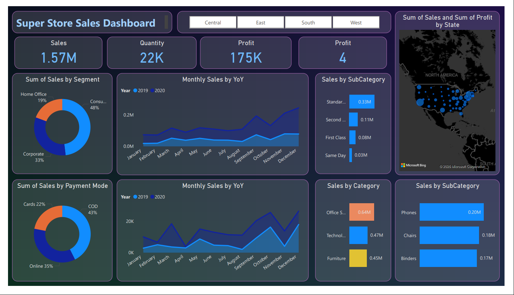
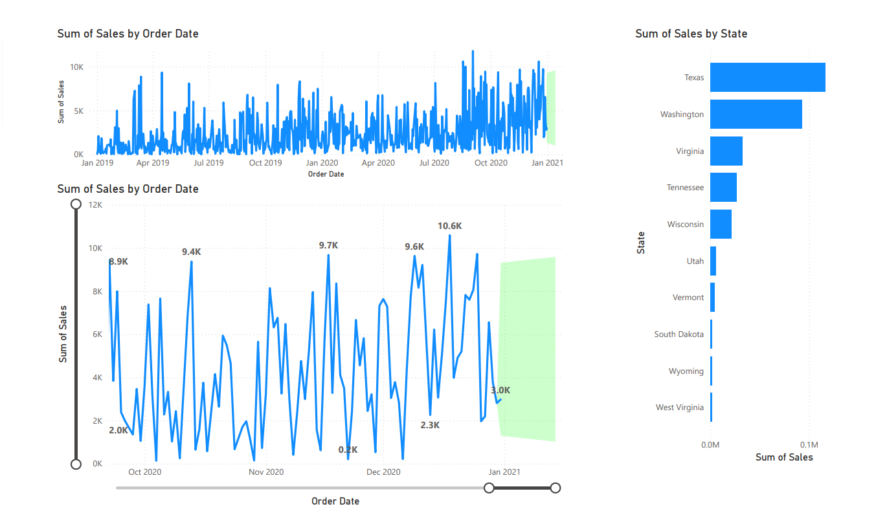

# 📊 Super Store Sales Dashboard | Power BI

An interactive sales analytics dashboard built in **Power BI** to explore sales, profit, quantity, customer segments, payment modes, product categories, shipping methods, and sales trends over time.

## 🎯 Project Objectives

- Monitor overall sales, quantity, and profit.
- Compare sales across customer segments and payment modes.
- Track monthly sales trends and year-over-year performance.
- Identify strong-performing product categories and sub-categories.
- Explore sales distribution across states.
- Analyze sales over time and review trend patterns.

## 🛠️ Tools & Technologies

- Microsoft Power BI Desktop
- Power Query
- Data Visualization
- Excel dataset

## 📂 Dataset

The project uses the supplied Super Store sales dataset in Excel format.

## 📊 Dashboard Overview

### 1. Sales Overview

The main dashboard includes the following KPI cards:

| KPI | Dashboard Value |
|---|---:|
| Sales | 1.57M |
| Quantity | 22K |
| Profit | 175K |
| Profit (additional KPI shown) | 4 |

**Visualizations include:**
- Sales by customer segment
- Monthly sales by year (2019 and 2020)
- Sales by shipping sub-category
- Sales by payment mode
- Sales by product category
- Sales by sub-category
- Sales and profit by state
- Region filters: Central, East, South, and West

### 2. Sales Trends and State Analysis

The second dashboard page focuses on sales over time and geographic comparison.

**Visualizations include:**
- Sales by order date
- Detailed sales trend over the selected date range
- Sales by state
- Date range selection for trend exploration

## 🔎 Dashboard Highlights

- Total sales shown: **1.57M**
- Total quantity shown: **22K**
- Total profit shown: **175K**
- Consumer segment contributes approximately **48%** of sales.
- COD accounts for approximately **43%** of sales by payment mode.
- Standard shipping contributes approximately **0.33M** in the displayed shipping sub-category chart.
- Office Supplies, Technology, and Furniture are compared in the category-level sales visual.
- The state chart highlights sales differences across locations, including Texas and Washington.

*Values above are transcribed from the supplied dashboard screenshots and may reflect the current report filters.*

## 📸 Dashboard Screenshots

### Sales Overview



### Sales Trends and State Analysis



## 📁 Repository Structure

```text
Super-Store-Sales-PowerBI/
│
├── Super_Store_Sales_Dashboard.pbit
├── Super_Store_Sales_Dashboard_Report.pdf
├── SuperStore_Sales_Dataset.xlsx
├── README.md
│
└── Screenshots/
    ├── Super_Store_Sales_Dashboard.png
    └── Sales_Trends_and_State_Analysis.png
```

## 🚀 How to Use

1. Download or clone this repository.
2. Open `Super_Store_Sales_Dashboard.pbit` in Power BI Desktop.
3. If prompted, point the template to `SuperStore_Sales_Dataset.xlsx` or the appropriate source file.
4. Refresh the data if required.
5. Explore the dashboard pages and use the region/date filters to interact with the visuals.

## 💡 Business Value

This dashboard can help business users monitor sales performance, compare customer segments and payment preferences, identify product categories that contribute to sales, and review trends across time and states.

## 👩‍💻 Author

**Divya Mohan Keni**

Aspiring Data Analyst | Power BI | SQL | Python | Excel | Tableau
